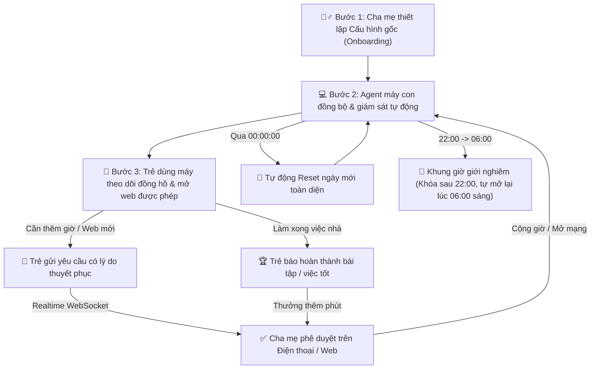

# 🛡️ MMT Project - Hệ Thống Quản Lý & Định Hướng Sử Dụng Máy Tính Cho Trẻ Em
> **Parental Control & Digital Well-being System**
> Hệ thống cân bằng giữa sự bảo vệ của cha mẹ và tính tự giác của trẻ em trên nền tảng Windows & Linux.
# 🛡️ MMT Project - Ứng dụng Quản Lý Máy Tính Trẻ Em

Đây là hệ thống hỗ trợ cha mẹ quản lý thời gian và hoạt động máy tính của trẻ em trên nền tảng Windows & Linux[cite: 1, 2]. Hệ thống cân bằng giữa sự kiểm soát của cha mẹ và tính minh bạch, giúp rèn luyện tính tự giác và thói quen sử dụng máy tính lành mạnh cho trẻ.

---

## 🛠 Công Nghệ & Kiến Trúc Hệ Thống

Hệ thống được xây dựng theo kiến trúc Client-Server hiện đại, linh hoạt và tối ưu độ trễ:
Hệ thống được thiết kế theo kiến trúc Client-Server gồm 3 thành phần chính[cite: 1]:
- **Cloud Backend:** Xây dựng bằng Python 3.11+, FastAPI, Uvicorn, và SQLAlchemy[cite: 2]. Sử dụng giao thức **REST API** cho các thao tác đồng bộ dữ liệu và **WebSocket** để truyền lệnh điều khiển thời gian thực với độ trễ cực thấp[cite: 1, 4].
- **Cơ sở dữ liệu (Database):** Sử dụng SQLite (môi trường phát triển) với các bảng quản lý người dùng (`users`), thiết bị (`devices`), quy tắc thời gian (`time_limits`), quy tắc web/app (`app_web_rules`), nhật ký sử dụng (`usage_logs`) và lịch sử yêu cầu (`time_requests`)[cite: 1, 2].
- **Client Agent (Máy con):** Chạy ngầm trên Windows/Linux, sử dụng thư viện `psutil`, `pywin32` kết hợp can thiệp tầng mạng (`/etc/hosts` IPv4/IPv6) để giám sát tiến trình, chặn trang web và thực thi chính sách giới hạn[cite: 1, 2].
- **Giao diện người dùng (UI):** Hỗ trợ cả giao diện Web (HTML/Tailwind CSS) và ứng dụng Desktop Native mượt mà bằng Python (`Tkinter`).

- **Cloud / Local Backend:**
  - Ngôn ngữ & Framework: **Python 3.11+**, **FastAPI**, **Uvicorn**, **SQLAlchemy**.
  - Giao thức: **REST API** (đồng bộ dữ liệu, thiết lập quy tắc, phân loại danh mục) và **WebSocket** (truyền tín hiệu điều khiển khẩn cấp, thông báo vi phạm, duyệt yêu cầu thời gian thực với độ trễ < 50ms).
- **Cơ sở dữ liệu (Database):**
  - **SQLite** với các bảng quan hệ: người dùng (`users`), thiết bị (`devices`), quy tắc thời gian (`time_limits`), quy tắc web & ứng dụng (`app_web_rules`), nhật ký sử dụng (`usage_logs`), lịch sử xin phép (`child_requests`), và nhiệm vụ việc tốt (`tasks`).
- **Client Agent (Máy Con):**
  - Chạy ngầm trên Windows và Linux.
  - Sử dụng thư viện `psutil` để giám sát tiến trình đang chạy và can thiệp tầng mạng (`/etc/hosts` IPv4/IPv6) để ngăn chặn tên miền vi phạm.
  - Duy trì danh sách `ALLOWED_TARGETS` động: chỉ chặn các mục trái phép và bảo vệ trình duyệt (Google Chrome, Edge...) không bị tắt nhầm khi trẻ truy cập trang web đã được duyệt.
- **Giao diện người dùng đa nền tảng (Cross-platform UI):**
  - **Giao diện Web Responsive:** HTML5, Tailwind CSS hiện đại, tương thích hoàn hảo từ Điện thoại thông minh (Mobile), Máy tính bảng (Tablet) cho tới Màn hình máy tính (Desktop).
  - **Ứng dụng Desktop Native:** Viết bằng Python `Tkinter`, chạy trực tiếp trên hệ điều hành không cần cài thêm trình duyệt.

---

## 🌟 Tính Năng Cốt Lõi Của Hệ Thống
## 🌟 Tính Năng Hệ Thống

### 1. Dành cho Cha Mẹ (Parent Dashboard)
- 🧙‍♂️ **Thiết lập lần đầu (Onboarding Setup Wizard):**
  - Cấu hình hạn mức thời gian dùng máy cho mục **Học tập** và **Giải trí**.
  - Thiết lập **Khung giờ giới nghiêm (Bedtime Mode)**: Tự động vô hiệu hóa máy tính từ 22:00 tối đến 06:00 sáng hôm sau (mặc định, cha mẹ có thể tùy chỉnh linh hoạt mốc giờ bắt đầu khóa và mốc giờ tự động mở lại).
  - Khởi tạo danh sách Web & Phần mềm được phép hoặc bị cấm ban đầu.
  - Khởi tạo danh sách việc cần làm mẫu (bài tập, việc nhà) để trẻ đổi lấy giờ sử dụng.
  - Lưu toàn bộ cấu hình làm **Thiết lập gốc (Base Template)** của gia đình.
- 🌅 **Tự động làm mới mỗi ngày (Daily Midnight Rollover):**
  - Khi bước sang ngày mới (sau 00:00:00), hệ thống tự động đặt lại thời gian đã dùng về 0 phút.
  - Mở lại toàn bộ các nhiệm vụ việc tốt hàng ngày sang trạng thái chưa làm (`TODO`) để trẻ tiếp tục rèn luyện thói quen tự giác.
- �‍👩‍👧‍👦 **Quản lý Hồ sơ Trẻ em & Đăng nhập máy (Child Profiles & PIN Login):**
  - Cha mẹ dễ dàng tạo hồ sơ riêng cho từng bé trong gia đình: Tên, Avatar ngộ nghĩnh, Tuổi, Mã PIN 4 số và Hạn mức hàng ngày.
  - Trên máy con, trẻ có thể chọn hồ sơ của mình và nhập mã PIN để đăng nhập với tư cách cá nhân, giúp cá nhân hóa quy tắc và thời gian học tập.
- 📊 **Thống kê thời gian với Biểu đồ trực quan thân thiện (Interactive Chart.js):**
  - Biểu đồ hình tròn Doughnut sinh động, màu sắc tươi sáng hiển thị tỷ lệ thời gian phân bổ:
    - 📚 **Học tập & Giáo dục** (Xanh lá)
    - 🎮 **Giải trí & Game** (Đỏ hồng)
    - 💬 **Mạng xã hội & Chat** (Xanh dương)
  - *(Đã lược bỏ danh mục Công cụ & Tiện ích nhằm tinh giản và tập trung vào các thói quen cốt lõi của trẻ)*.
- ⚡ **Thiết lập thời gian tự điền (Smart Auto-fill & Quick Presets):**
  - Tính năng **Tự điền hạn mức khuyên dùng** một chạm cho tất cả ứng dụng (Học tập 120p, Giải trí 45p, MXH 30p).
  - Các nút chọn nhanh hạn mức trực tiếp (`30p`, `45p`, `60p`, `90p`, `120p`, `Không GH`) bên cạnh từng ứng dụng giúp cha mẹ điều chỉnh tức thì mà không cần gõ phím.
- 🚨 **Cảnh báo khi trẻ tự ý truy cập các web lạ & Quản lý Web/App chặn:**
  - Bộ lọc thông minh ngăn chặn ngay lập tức khi trẻ cố tình gõ hoặc mở các trang web lạ chưa nằm trong danh sách an toàn.
  - Hiển thị màn hình cảnh báo trên máy con, đồng thời gửi thông báo đỏ tức thời qua WebSocket về Trạm điều khiển của cha mẹ kèm lịch sử nhật ký (`AlertLog`).
- 🌙 **Thời gian vô hiệu hóa tùy chỉnh theo phụ huynh (Bedtime Mode):**
  - Cha mẹ chủ động cài đặt khung giờ giới nghiêm ban đêm (mặc định 22:00 tối đến 06:00 sáng) ngay trên bảng điều khiển với các mẫu cấu hình nhanh (Học kỳ `21:30 - 06:00`, Chuẩn `22:00 - 06:00`, Cuối tuần `23:00 - 07:00`).
  - Hệ thống tự động vô hiệu hóa máy khi đến giờ ngủ và tự động mở lại đúng giờ thức dậy.
- ⚡ **Điều khiển từ xa & Gửi thông điệp tức thì:**
  - Khóa khẩn cấp / Mở khóa màn hình máy con ngay lập tức qua WebSocket.
  - Gửi lời nhắn nhanh tới màn hình của trẻ (VD: *"Hết giờ rồi, chuẩn bị ăn cơm con nhé!"*).
- 📩 **Hộp thư phê duyệt yêu cầu:**
  - Tiếp nhận thông báo đẩy tức thì khi trẻ xin thêm giờ hoặc xin mở web mới.
  - Xem lý do của trẻ và gửi kèm lời dặn dò khi bấm duyệt (`✅ Cho phép` / `❌ Từ chối`).
- 🔄 **Trung tâm Đặt lại (Reset Center):**
  - 🌅 *Reset Ngày Mới*: Đưa thời gian đã dùng về 0 và kích hoạt lại danh sách việc tốt.
  - ⏱️ *Reset Thời Gian*: Đặt lại số phút sử dụng hôm nay về 0.
  - 🛡️ *Reset Quy Tắc*: Khôi phục danh sách web/app về chuẩn mặc định.
  - 🧹 *Làm Sạch Hộp Thư*: Xóa toàn bộ lịch sử yêu cầu cũ.
  - ⚠️ *Khôi Phục Cài Đặt Gốc*: Khôi phục toàn diện hệ thống về trạng thái ban đầu.
- 🧙‍♂️ **Thiết lập lần đầu (Onboarding Setup):** Lần đầu truy cập, hệ thống yêu cầu phụ huynh thiết lập cấu hình gốc (phân mục Học tập/Giải trí, danh sách Web & App cho phép hoặc bị chặn, định mức thời gian cho từng loại) và lưu lại làm quy chuẩn cho các phiên sau[cite: 1].
- 📊 **Thống kê & Giới hạn thời gian:** Theo dõi số phút đã dùng thực tế và cài đặt hạn mức thời gian tối đa (VD: 30 phút, 60 phút, 120 phút hoặc Không giới hạn) cho từng mục[cite: 1].
- 🛡️ **Quản lý Quy tắc Web & Phần mềm:** Xem và điều chỉnh linh hoạt danh sách các web/app được phép (`ALLOW`) hoặc bị chặn (`BLOCK`)[cite: 1].
- ⚡ **Điều khiển từ xa (Real-time):** Khóa/mở khóa máy khẩn cấp hoặc gửi thông điệp nhắc nhở tới màn hình của con ngay lập tức qua WebSocket[cite: 1, 4].
- 📩 **Xử lý yêu cầu:** Xem, phê duyệt (`✅ Cho phép`) hoặc từ chối (`❌ Từ chối`) các yêu cầu xin thêm giờ hoặc xin mở khóa ứng dụng từ trẻ[cite: 1].
- 🔄 **Cài Đặt & Đặt Lại Hệ Thống (Reset):**
  - ⏱️ *Reset Usage*: Đặt lại thời gian sử dụng hôm nay về 0 để bắt đầu ngày mới.
  - 🛡️ *Reset Rules*: Đưa danh sách quy tắc Web & App về cấu hình mặc định.
  - 🧹 *Clear Requests*: Làm sạch hộp thư yêu cầu cũ.
  - ⚠️ *Full Reset*: Khôi phục toàn bộ hệ thống về trạng thái cài đặt gốc.

---

### 2. Dành cho Trẻ Em (Child Dashboard)
- 🧒 **Đăng nhập với tư cách trẻ (Child Profile Login):**
  - Trẻ bấm chọn hình đại diện của mình và nhập mã PIN để đăng nhập vào máy tính, nhận diện đúng tài khoản của mình.
- 🌐 **Kiểm tra Website & Cảnh báo Web lạ (Safe Web Checker):**
  - Ô kiểm tra an toàn trực tuyến: Trẻ gõ tên trang web muốn truy cập. Nếu an toàn, hệ thống tự động mở; nếu là trang web lạ chưa được cha mẹ duyệt, hệ thống lập tức phát cảnh báo và cho phép trẻ gửi nhanh lời xin phép có lý do.
- 🍩 **Biểu đồ thời gian trực quan cho trẻ (Child Doughnut Chart):**
  - Đồ thị màu sắc thân thiện giúp trẻ tự nhận thức và cân đối thời gian giữa Học tập, Giải trí và Mạng xã hội.
- 🟢 **Danh sách Web & Phần mềm được duyệt (Allowed Targets):**
  - Hiển thị đầy đủ các trang web và phần mềm cha mẹ đã cho phép kèm hạn mức thời gian.
  - Nút **`Mở trang web ↗`** giúp trẻ mở trực tiếp trang web trên tab trình duyệt mà không lo bị chặn nhầm.
- ⏳ **Đồng hồ đếm ngược minh bạch (Transparent Countdown):**
  - Đồng hồ đếm ngược trực tiếp dạng `hh:mm:ss` với trạng thái trực quan:
    - 🟢 *Thời gian an toàn:* Còn trên 15 phút.
    - 🟡 *Chuẩn bị hết giờ:* Còn dưới 15 phút.
    - 🔴 *Báo động khẩn cấp:* Còn dưới 5 phút.
    - ⛔ *Hết giờ:* Chuyển sang trạng thái khóa.
- 🔔 **Cảnh báo sớm bảo vệ tài liệu (Graceful Shutdown Alerts):**
  - Báo động nhắc nhở trước 15 phút và 5 phút để trẻ kịp thời lưu (Save) bài tập, tài liệu đang làm trước khi hết giờ.
- 🌙 **Khung giờ giới nghiêm (Bedtime Mode: Vô hiệu hóa sau 22:00, tự mở lại vào 06:00 sáng):**
  - Tự động khóa và vô hiệu hóa máy tính từ 22:00 tối để bảo vệ giấc ngủ và sức khỏe của trẻ, sau đó tự động mở khóa trở lại vào 06:00 sáng hôm sau (mặc định, cha mẹ có thể tùy chỉnh mốc giờ theo ý muốn).
  - Client Agent và Child Dashboard liên tục đồng bộ trạng thái, thông báo rõ ràng khung giờ giới nghiêm và tự động khôi phục quyền dùng máy ngay khi đến giờ thức dậy.
- 🏆 **Đổi việc tốt lấy giờ chơi (Gamification):**
  - Trẻ xem danh sách bài tập hoặc việc nhà cha mẹ giao.
  - Sau khi hoàn thành, bấm **`Báo đã làm xong 🏆`** để cha mẹ duyệt và cộng thưởng thêm phút sử dụng.
- 🔓 **Xin thêm giờ & Xin mở trang web mới:**
  - Gửi biểu mẫu xin thêm giờ (+15p, +30p, +60p) kèm lý do chính đáng tới cha mẹ.
  - Gửi yêu cầu xin mở khóa một Website hoặc Phần mềm mới.
- 📋 **Lịch sử & Đọc lời dặn dò:**
  - Xem kết quả phê duyệt và lời nhắn từ cha mẹ ngay trên màn hình.
- 🟢 **Danh sách Web & Phần mềm được phép:** Đồng bộ danh sách `ALLOWED_TARGETS` từ máy chủ. Cung cấp nút **`Mở trang web ↗`** để mở trực tiếp trong tab mới, tránh việc bị chặn nhầm trình duyệt.
- ⏳ **Đồng hồ đếm ngược minh bạch:** Hiển thị thời gian còn lại trực quan (🟢 Còn nhiều, 🟡 Sắp hết, 🔴 Đã hết giờ) giúp trẻ tự chủ động sắp xếp việc học và chơi[cite: 1].
- 🔓 **Xin thêm giờ & Mở khóa:** Cho phép gửi biểu mẫu xin mở một Website/Phần mềm mới hoặc xin thêm thời gian (+15p, +30p, +1h) kèm theo lý do thuyết phục gửi tới cha mẹ[cite: 1].
- 📋 **Lịch sử & Phản hồi:** Theo dõi trạng thái phê duyệt và đọc lời nhắn dặn dò từ cha mẹ[cite: 1].

---

## 📱 Khả Năng Tương Thích & Sử Dụng Đa Thiết Bị
## 🔮 Hướng Phát Triển Mở Rộng (Future Roadmap)
- 🌙 **Khung giờ giới nghiêm (Bedtime Mode):** Tự động khóa máy sau 22:00 bất kể thời lượng sử dụng trong ngày vẫn còn[cite: 1].
- 🏆 **Đổi việc tốt lấy giờ chơi (Gamification):** Cha mẹ tạo danh sách việc nhà/bài tập trên app, trẻ hoàn thành để nhận thưởng thêm phút sử dụng[cite: 1].
- 🔔 **Cảnh báo sớm (Graceful Shutdown):** Nhắc nhở trước 15 phút và 5 phút khi sắp hết giờ để trẻ kịp lưu tài liệu học tập[cite: 1].
- 🔒 **Chống tắt ngầm (Anti-Tamper Service):** Đóng gói Agent thành System Service/Daemon và bảo vệ bằng mật khẩu Admin để chống tắt qua Task Manager[cite: 1].

Giao diện Web của hệ thống được thiết kế theo tiêu chuẩn Mobile-First và Fully Responsive:

- **📱 Trên Điện Thoại Di Động (Smartphones - iOS / iPhone & Android):**
  - Giao diện tự động co giãn tối ưu cho màn hình cảm ứng từ 360px đến 480px.
  - Phụ huynh có thể mở trình duyệt (Safari, Chrome) trên điện thoại, truy cập `http://<IP_MÁY_CHỦ>:8000/parent/` qua mạng Wi-Fi gia đình để duyệt yêu cầu, khóa/mở khóa máy con từ xa và gửi lời nhắn ngay khi đang ở phòng khách hoặc nấu ăn.
- **📟 Trên Máy Tính Bảng (Tablets - iPad & Android Tablet):**
  - Bố cục lưới đa cột trực quan (768px đến 1024px), thuận tiện xem biểu đồ thời gian sử dụng, phân loại danh mục và giao việc tốt cho con.
- **💻 Trên Máy Tính Cá Nhân (Desktop / Laptop - Windows & Linux):**
  - Hỗ trợ đầy đủ cả giao diện Web trên trình duyệt và ứng dụng Desktop Native (`Python Tkinter`) độc lập, nhẹ và khởi động tức thì.

---

## 🚀 Hướng Dẫn Cài Đặt & Khởi Chạy
## 🚀 Hướng Dẫn Khởi Chạy Hệ Thống

### 1. Chuẩn bị Môi trường
Dự án yêu cầu **Python 3.11+**. Mở Terminal tại thư mục gốc và khởi tạo môi trường ảo:
### 1. Khởi động Backend (FastAPI Server)
Mở Terminal 1 tại thư mục gốc của dự án và chạy lệnh:
```bash
# Tạo và kích hoạt virtual environment
python3 -m venv .venv
source .venv/bin/activate    # Trên Linux/macOS
# hoặc: .venv\Scripts\activate trên Windows

# Cài đặt các thư viện cần thiết cho toàn bộ hệ thống (Backend & Client Agent)
pip install -r requirements.txt
```

---

### 2. Khởi động Backend Server
```bash
# Kích hoạt môi trường ảo
source .venv/bin/activate
uvicorn backend.app.main:app --host 0.0.0.0 --port 8008 --reload
```
> **Mẹo:** Hệ thống tự động tương thích cả cổng `8008` lẫn `8000`. Nếu cổng 8000 đang được ứng dụng khác trên máy sử dụng, chạy với `--port 8008` (mặc định khuyến nghị).
- **Cổng điều hướng tổng hợp:** Mở trình duyệt tại `http://localhost:8008/` (hoặc `http://<IP_LAN>:8008/` từ điện thoại/tablet).
- **Tài liệu API Swagger:** Truy cập `http://localhost:8008/docs`.

---
# Chạy server FastAPI
uvicorn backend.app.main:app --reload --port 8000

### 3. Khởi chạy Giao diện Phụ Huynh (Parent Dashboard)
- **Truy cập qua Web (Điện thoại / Tablet / Máy tính):**
  - Địa chỉ: `http://localhost:8008/parent/` (hoặc `http://<IP_LAN>:8008/parent/` trên điện thoại kết nối cùng Wi-Fi).
  - Hoặc mở trực tiếp file `parent-app/index.html` trên trình duyệt (hệ thống sẽ tự động dò tìm cổng backend).
- **Chạy ứng dụng Desktop Native (Tkinter):**
  ```bash
  source .venv/bin/activate
  python parent-app/parent_dashboard.py
  ```

---
## Quy Trình Vận Hành Thực Tế (User Workflow)

### 4. Khởi chạy Giao diện Con Cái (Child Dashboard)
- **Truy cập qua Web (Máy tính / Tablet):**
  - Địa chỉ: `http://localhost:8008/child/` (hoặc `http://<IP_LAN>:8008/child/`).
  - Hoặc mở trực tiếp file `child-app/index.html` trên trình duyệt.
- **Chạy ứng dụng Desktop Native (Tkinter):**
  ```bash
  source .venv/bin/activate
  python child-app/child_dashboard.py
  ```

---

### 5. Khởi động Client Agent (Máy Con)
Mở một Terminal riêng trên máy tính của con và chạy:
```bash
source .venv/bin/activate

# Khởi chạy Agent giám sát & bảo vệ
python agent/agent_main.py
```
> **Lưu ý:** Để Agent có toàn quyền ghi file cấu hình mạng `/etc/hosts` và kiểm soát tiến trình hệ thống, hãy chạy lệnh với quyền Quản trị viên (`sudo python agent/agent_main.py` trên Linux hoặc `Run as Administrator` trên Windows).

---

## 🔄 Quy Trình Vận Hành & Trải Nghiệm Thực Tế (Workflow)



1. **Bước 1 - Khởi tạo & Cấu hình Gốc:**
   - Cha mẹ mở Parent Dashboard, thiết lập hạn mức thời gian Học tập / Giải trí, khung giờ giới nghiêm ban đêm (22:00 tối đến 06:00 sáng, tùy chỉnh), danh sách web/app và việc tốt hàng ngày cho con.
2. **Bước 2 - Đồng Bộ & Giám Sát Tự Động:**
   - Client Agent kết nối WebSocket với máy chủ, tải danh sách `ALLOWED_TARGETS` và kích hoạt bộ lọc tiến trình/mạng.
3. **Bước 3 - Minh Bạch Thời Gian & Tương Tác 2 Chiều:**
   - Trẻ mở Child Dashboard quan sát đồng hồ đếm ngược trực quan, bấm nút `Mở trang web ↗` để học tập mà không bị chặn. Khi cần thêm thời gian, trẻ gửi form xin phép có lý do.
   - Cha mẹ nhận thông báo ngay trên điện thoại hoặc máy tính và phê duyệt tức thì.
4. **Bước 4 - Đổi Việc Tốt & Tự Động Làm Mới Mỗi Ngày:**
   - Trẻ hoàn thành bài tập, bấm `Báo đã làm xong 🏆` để nhận thưởng giờ chơi.
   - Khi thời gian sắp hết, hệ thống phát cảnh báo sớm ở mốc 15 phút và 5 phút. Khi bước sang ngày mới, hệ thống tự động đặt lại toàn bộ hạn mức về 0 để con bắt đầu một ngày học tập và vui chơi lành mạnh.

---

## 🔮 Hướng Phát Triển Mở Rộng (Future Roadmap)

- 🤖 **AI Content Filtering:** Tích hợp mô hình AI phân tích văn bản và hình ảnh theo thời gian thực để ngăn chặn nội dung không phù hợp ngay trên luồng hiển thị.
- 🔒 **Anti-Tamper Windows Service / Systemd Daemon:** Đóng gói Agent thành dịch vụ hệ thống chạy ngầm được khóa bằng mật khẩu Quản trị viên chống tắt qua Task Manager.
- ☁️ **Cloud Remote Sync (Over WAN):** Kết nối P2P VPN hoặc Cloud Relay giúp cha mẹ quản lý máy con từ xa ngay cả khi không ở chung mạng Wi-Fi gia đình.
- Khởi tạo (Máy Cha Mẹ): Cha mẹ mở Parent Dashboard, tạo hồ sơ thiết bị cho con và thiết lập quy tắc ban đầu (thời gian giới hạn, các web đen/game cần chặn).
- Cài đặt & Ghép nối (Máy Con): Cha mẹ tải và chạy Client Agent trên máy tính của con dưới quyền Quản trị viên (Admin/Root). Agent tự động lấy mã phần cứng (device_hwid) để liên kết với máy chủ Backend và tải cấu hình của cha mẹ về áp dụng.
- Giám sát tự động: Trong quá trình con dùng máy, Agent chạy ngầm theo dõi thời gian thực tế, chặn các tiến trình vi phạm bằng psutil và chặn tên miền cấm qua '/etc/hosts'[cite: 1, 3].
- Tương tác 2 chiều: Khi hết giờ hoặc cần vào web học tập bị chặn, con mở Child Dashboard gửi yêu cầu $\rightarrow$ Cha mẹ nhận thông báo trên Parent Dashboard và bấm duyệt $\rightarrow$ Máy con tự động được cộng thêm giờ hoặc mở khóa trang web ngay lập tức qua WebSocket.
