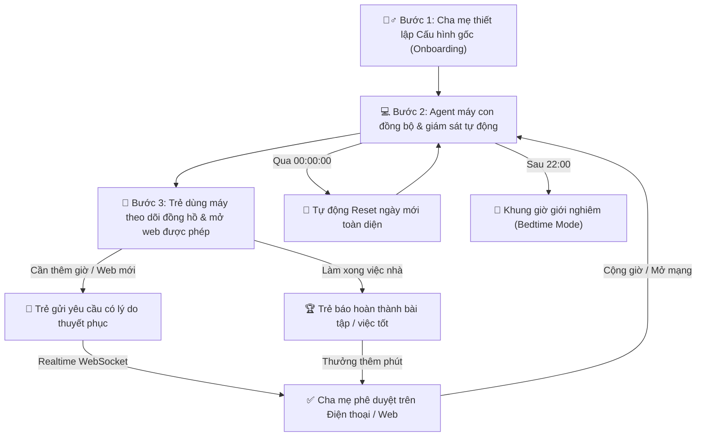

# 🛡️ MMT Project - Hệ Thống Quản Lý & Định Hướng Sử Dụng Máy Tính Cho Trẻ Em
> **Parental Control & Digital Well-being System**
> Hệ thống cân bằng giữa sự bảo vệ của cha mẹ và tính tự giác của trẻ em trên nền tảng Windows & Linux.

---

## 🛠 Công Nghệ & Kiến Trúc Hệ Thống

Hệ thống được xây dựng theo kiến trúc Client-Server hiện đại, linh hoạt và tối ưu độ trễ:

- **Cloud / Local Backend:**
  - Ngôn ngữ & Framework: **Python 3.11+**, **FastAPI**, **Uvicorn**, **SQLAlchemy**.
  - Giao thức: **REST API** (đồng bộ dữ liệu, thiết lập quy tắc, phân loại danh mục) và **WebSocket** (truyền tín hiệu điều khiển khẩn cấp, thông báo vi phạm, duyệt yêu cầu thời gian thực với độ trễ < 50ms).
- **Cơ sở dữ liệu (Database):**
  - **SQLite** với các bảng quan hệ: người dùng (`users`), thiết bị (`devices`), quy tắc thời gian (`time_limits`), quy tắc web & ứng dụng (`app_web_rules`), nhật ký sử dụng (`usage_logs`), lịch sử xin phép (`child_requests`), và nhiệm vụ việc tốt (`tasks`).
- **Client Agent (Máy Con):**
  - Chạy ngầm trên Windows và Linux.
  - Sử dụng thư viện `psutil` để giám sát tiến trình đang chạy và can thiệp tầng mạng (`/etc/hosts` IPv4/IPv6) để ngăn chặn tên miền vi phạm.
  - Duy trì danh sách `ALLOWED_TARGETS` động: chỉ chặn các mục trái phép và bảo vệ trình duyệt (Google Chrome, Edge...) không bị tắt nhầm khi trẻ truy cập trang web đã được duyệt.
- **Giao diện người dùng đa nền tảng (Cross-platform UI):**
  - **Giao diện Web Responsive:** HTML5, Tailwind CSS hiện đại, tương thích hoàn hảo từ Điện thoại thông minh (Mobile), Máy tính bảng (Tablet) cho tới Màn hình máy tính (Desktop).
  - **Ứng dụng Desktop Native:** Viết bằng Python `Tkinter`, chạy trực tiếp trên hệ điều hành không cần cài thêm trình duyệt.

---

## 🌟 Tính Năng Cốt Lõi Của Hệ Thống

### 1. Dành cho Cha Mẹ (Parent Dashboard)
- 🧙‍♂️ **Thiết lập lần đầu (Onboarding Setup Wizard):**
  - Cấu hình hạn mức thời gian dùng máy cho mục **Học tập** và **Giải trí**.
  - Thiết lập **Khung giờ giới nghiêm (Bedtime Mode)** (mặc định sau 22:00).
  - Khởi tạo danh sách Web & Phần mềm được phép hoặc bị cấm ban đầu.
  - Khởi tạo danh sách việc cần làm mẫu (bài tập, việc nhà) để trẻ đổi lấy giờ sử dụng.
  - Lưu toàn bộ cấu hình làm **Thiết lập gốc (Base Template)** của gia đình.
- 🌅 **Tự động làm mới mỗi ngày (Daily Midnight Rollover):**
  - Khi bước sang ngày mới (sau 00:00:00), hệ thống tự động đặt lại thời gian đã dùng về 0 phút.
  - Mở lại toàn bộ các nhiệm vụ việc tốt hàng ngày sang trạng thái chưa làm (`TODO`) để trẻ tiếp tục rèn luyện thói quen tự giác.
- 📊 **Thống kê & Giới hạn thời gian chi tiết:**
  - Phân loại rõ ràng 4 danh mục với biểu tượng và màu sắc nhận diện:
    - 📚 **Học tập & Giáo dục**
    - 🎮 **Giải trí & Game**
    - 💬 **Mạng xã hội & Chat**
    - 🛠️ **Công cụ & Tiện ích**
  - Cài đặt thời lượng tối đa cho từng mục và theo dõi chính xác thời gian con đã dùng trong ngày.
- 🛡️ **Quản lý Quy tắc Web & Phần mềm:**
  - Bổ sung hoặc thu hồi quyền truy cập Web/App bất kỳ lúc nào.
- ⚡ **Điều khiển từ xa & Gửi thông điệp tức thì:**
  - Khóa khẩn cấp / Mở khóa màn hình máy con ngay lập tức qua WebSocket.
  - Gửi lời nhắn nhanh tới màn hình của trẻ (VD: *"Hết giờ rồi, chuẩn bị ăn cơm con nhé!"*).
- 📩 **Hộp thư phê duyệt yêu cầu:**
  - Tiếp nhận thông báo đẩy tức thì khi trẻ xin thêm giờ hoặc xin mở web mới.
  - Xem lý do của trẻ và gửi kèm lời dặn dò khi bấm duyệt (`✅ Cho phép` / `❌ Từ chối`).
- 🔄 **Trung tâm Đặt lại (Reset Center):**
  - 🌅 *Reset Ngày Mới*: Đưa thời gian đã dùng về 0 và kích hoạt lại danh sách việc tốt.
  - ⏱️ *Reset Thời Gian*: Đặt lại số phút sử dụng hôm nay về 0.
  - 🛡️ *Reset Quy Tắc*: Khôi phục danh sách web/app về chuẩn mặc định.
  - 🧹 *Làm Sạch Hộp Thư*: Xóa toàn bộ lịch sử yêu cầu cũ.
  - ⚠️ *Khôi Phục Cài Đặt Gốc*: Khôi phục toàn diện hệ thống về trạng thái ban đầu.

---

### 2. Dành cho Trẻ Em (Child Dashboard)
- 🟢 **Danh sách Web & Phần mềm được duyệt (Allowed Targets):**
  - Hiển thị đầy đủ các trang web và phần mềm cha mẹ đã cho phép kèm hạn mức thời gian.
  - Nút **`Mở trang web ↗`** giúp trẻ mở trực tiếp trang web trên tab trình duyệt mà không lo bị chặn nhầm.
- ⏳ **Đồng hồ đếm ngược minh bạch (Transparent Countdown):**
  - Đồng hồ đếm ngược trực tiếp dạng `hh:mm:ss` với trạng thái trực quan:
    - 🟢 *Thời gian an toàn:* Còn trên 15 phút.
    - 🟡 *Chuẩn bị hết giờ:* Còn dưới 15 phút.
    - 🔴 *Báo động khẩn cấp:* Còn dưới 5 phút.
    - ⛔ *Hết giờ:* Chuyển sang trạng thái khóa.
- 🔔 **Cảnh báo sớm bảo vệ tài liệu (Graceful Shutdown Alerts):**
  - Báo động nhắc nhở trước 15 phút và 5 phút để trẻ kịp thời lưu (Save) bài tập, tài liệu đang làm trước khi hết giờ.
- 🌙 **Khung giờ giới nghiêm (Bedtime Mode):**
  - Tự động hiển thị màn hình nhắc nhở đi ngủ sau 22:00 bất kể thời gian sử dụng trong ngày vẫn còn, giúp trẻ giữ gìn sức khỏe và giấc ngủ.
- 🏆 **Đổi việc tốt lấy giờ chơi (Gamification):**
  - Trẻ xem danh sách bài tập hoặc việc nhà cha mẹ giao.
  - Sau khi hoàn thành, bấm **`Báo đã làm xong 🏆`** để cha mẹ duyệt và cộng thưởng thêm phút sử dụng.
- 🔓 **Xin thêm giờ & Xin mở trang web mới:**
  - Gửi biểu mẫu xin thêm giờ (+15p, +30p, +60p) kèm lý do chính đáng tới cha mẹ.
  - Gửi yêu cầu xin mở khóa một Website hoặc Phần mềm mới.
- 📋 **Lịch sử & Đọc lời dặn dò:**
  - Xem kết quả phê duyệt và lời nhắn từ cha mẹ ngay trên màn hình.

---

## 📱 Khả Năng Tương Thích & Sử Dụng Đa Thiết Bị

Giao diện Web của hệ thống được thiết kế theo tiêu chuẩn Mobile-First và Fully Responsive:

- **📱 Trên Điện Thoại Di Động (Smartphones - iOS / iPhone & Android):**
  - Giao diện tự động co giãn tối ưu cho màn hình cảm ứng từ 360px đến 480px.
  - Phụ huynh có thể mở trình duyệt (Safari, Chrome) trên điện thoại, truy cập `http://<IP_MÁY_CHỦ>:8000/parent/` qua mạng Wi-Fi gia đình để duyệt yêu cầu, khóa/mở khóa máy con từ xa và gửi lời nhắn ngay khi đang ở phòng khách hoặc nấu ăn.
- **📟 Trên Máy Tính Bảng (Tablets - iPad & Android Tablet):**
  - Bố cục lưới đa cột trực quan (768px đến 1024px), thuận tiện xem biểu đồ thời gian sử dụng, phân loại danh mục và giao việc tốt cho con.
- **💻 Trên Máy Tính Cá Nhân (Desktop / Laptop - Windows & Linux):**
  - Hỗ trợ đầy đủ cả giao diện Web trên trình duyệt và ứng dụng Desktop Native (`Python Tkinter`) độc lập, nhẹ và khởi động tức thì.

---

## 🚀 Hướng Dẫn Cài Đặt & Khởi Chạy

### 1. Chuẩn bị Môi trường
Dự án yêu cầu **Python 3.11+**. Mở Terminal tại thư mục gốc và khởi tạo môi trường ảo:
```bash
# Tạo và kích hoạt virtual environment
python3 -m venv .venv
source .venv/bin/activate    # Trên Linux/macOS
# hoặc: .venv\Scripts\activate trên Windows

# Cài đặt các thư viện cần thiết
pip install -r backend/requirements.txt
```

---

### 2. Khởi động Backend Server
```bash
source .venv/bin/activate
uvicorn backend.app.main:app --host 0.0.0.0 --port 8008 --reload
```
> **Mẹo:** Hệ thống tự động tương thích cả cổng `8008` lẫn `8000`. Nếu cổng 8000 đang được ứng dụng khác trên máy sử dụng, chạy với `--port 8008` (mặc định khuyến nghị).
- **Cổng điều hướng tổng hợp:** Mở trình duyệt tại `http://localhost:8008/` (hoặc `http://<IP_LAN>:8008/` từ điện thoại/tablet).
- **Tài liệu API Swagger:** Truy cập `http://localhost:8008/docs`.

---

### 3. Khởi chạy Giao diện Phụ Huynh (Parent Dashboard)
- **Truy cập qua Web (Điện thoại / Tablet / Máy tính):**
  - Địa chỉ: `http://localhost:8008/parent/` (hoặc `http://<IP_LAN>:8008/parent/` trên điện thoại kết nối cùng Wi-Fi).
  - Hoặc mở trực tiếp file `parent-app/index.html` trên trình duyệt (hệ thống sẽ tự động dò tìm cổng backend).
- **Chạy ứng dụng Desktop Native (Tkinter):**
  ```bash
  source .venv/bin/activate
  python parent-app/parent_dashboard.py
  ```

---

### 4. Khởi chạy Giao diện Con Cái (Child Dashboard)
- **Truy cập qua Web (Máy tính / Tablet):**
  - Địa chỉ: `http://localhost:8008/child/` (hoặc `http://<IP_LAN>:8008/child/`).
  - Hoặc mở trực tiếp file `child-app/index.html` trên trình duyệt.
- **Chạy ứng dụng Desktop Native (Tkinter):**
  ```bash
  source .venv/bin/activate
  python child-app/child_dashboard.py
  ```

---

### 5. Khởi động Client Agent (Máy Con)
Mở một Terminal riêng trên máy tính của con và chạy:
```bash
source .venv/bin/activate

# Khởi chạy Agent giám sát & bảo vệ
python agent/agent_main.py
```
> **Lưu ý:** Để Agent có toàn quyền ghi file cấu hình mạng `/etc/hosts` và kiểm soát tiến trình hệ thống, hãy chạy lệnh với quyền Quản trị viên (`sudo python agent/agent_main.py` trên Linux hoặc `Run as Administrator` trên Windows).

---

## 🔄 Quy Trình Vận Hành & Trải Nghiệm Thực Tế (Workflow)



1. **Bước 1 - Khởi tạo & Cấu hình Gốc:**
   - Cha mẹ mở Parent Dashboard, thiết lập hạn mức thời gian Học tập / Giải trí, giờ giới nghiêm ban đêm, danh sách web/app và việc tốt hàng ngày cho con.
2. **Bước 2 - Đồng Bộ & Giám Sát Tự Động:**
   - Client Agent kết nối WebSocket với máy chủ, tải danh sách `ALLOWED_TARGETS` và kích hoạt bộ lọc tiến trình/mạng.
3. **Bước 3 - Minh Bạch Thời Gian & Tương Tác 2 Chiều:**
   - Trẻ mở Child Dashboard quan sát đồng hồ đếm ngược trực quan, bấm nút `Mở trang web ↗` để học tập mà không bị chặn. Khi cần thêm thời gian, trẻ gửi form xin phép có lý do.
   - Cha mẹ nhận thông báo ngay trên điện thoại hoặc máy tính và phê duyệt tức thì.
4. **Bước 4 - Đổi Việc Tốt & Tự Động Làm Mới Mỗi Ngày:**
   - Trẻ hoàn thành bài tập, bấm `Báo đã làm xong 🏆` để nhận thưởng giờ chơi.
   - Khi thời gian sắp hết, hệ thống phát cảnh báo sớm ở mốc 15 phút và 5 phút. Khi bước sang ngày mới, hệ thống tự động đặt lại toàn bộ hạn mức về 0 để con bắt đầu một ngày học tập và vui chơi lành mạnh.

---

## 🔮 Hướng Phát Triển Mở Rộng (Future Roadmap)

- 🤖 **AI Content Filtering:** Tích hợp mô hình AI phân tích văn bản và hình ảnh theo thời gian thực để ngăn chặn nội dung không phù hợp ngay trên luồng hiển thị.
- 🔒 **Anti-Tamper Windows Service / Systemd Daemon:** Đóng gói Agent thành dịch vụ hệ thống chạy ngầm được khóa bằng mật khẩu Quản trị viên chống tắt qua Task Manager.
- ☁️ **Cloud Remote Sync (Over WAN):** Kết nối P2P VPN hoặc Cloud Relay giúp cha mẹ quản lý máy con từ xa ngay cả khi không ở chung mạng Wi-Fi gia đình.
